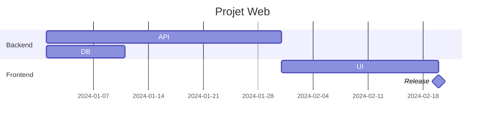
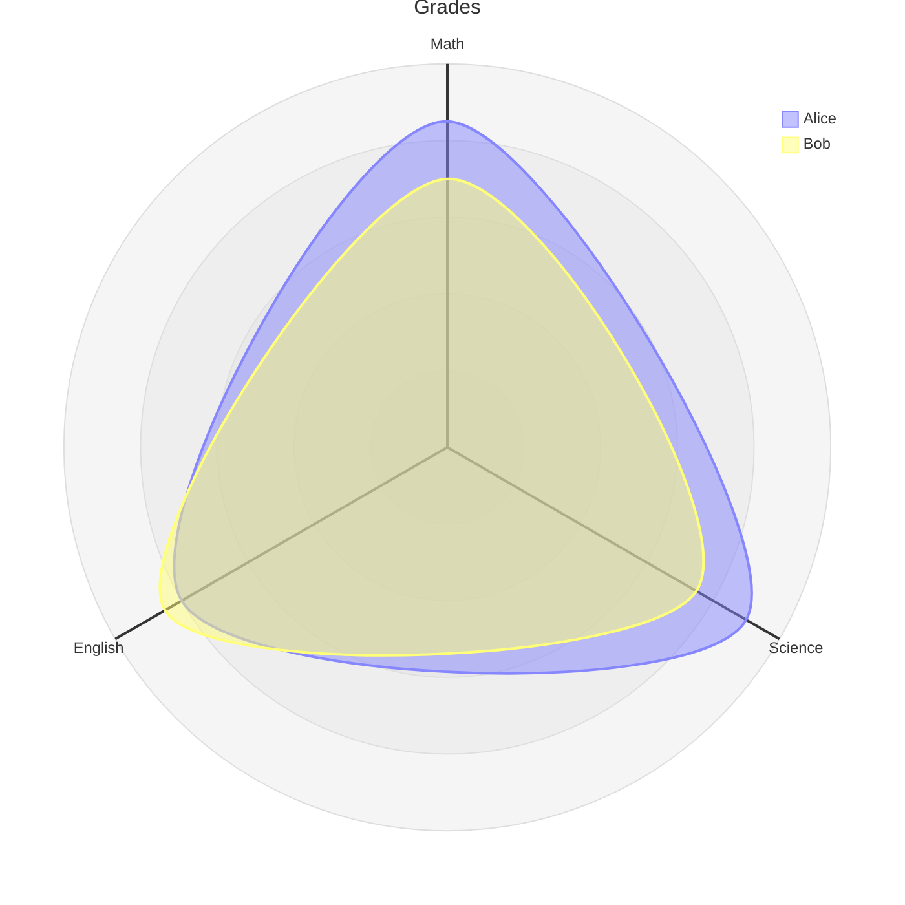

# pi-mermaid-extra

Render **28 Mermaid diagram types** as Unicode art directly in the [pi](https://pi.dev) TUI — including gantt, radar, treemap, venn, block, C4, agentflow, eventmodeling, zenuml and railroad diagrams.

Zero dependencies. No browser, no image files: diagrams are drawn in the transcript.

## Why

Pi ships with built-in Mermaid rendering (via [`grok-mermaid`](https://github.com/xl0/grok-mermaid)), but it only supports 5 diagram types: `flowchart`, `sequenceDiagram`, `classDiagram`, `stateDiagram-v2` and `erDiagram`. Everything else falls back to a raw code block.

This extension registers an additional `MarkdownTransformer` (the same official extension API hook) and renders all the types below that the built-in renderer leaves behind.

## Supported types

| Category | Types |
|---|---|
| Already built-in | `flowchart` · `sequenceDiagram` · `classDiagram` · `stateDiagram-v2` · `erDiagram` |
| Charts & data | `pie` · `xychart-beta` · `radar-beta` · `quadrantChart` · `treemap-beta` · `wardley-beta` · `venn-beta` · `sankey-beta` |
| Planning | `gantt` · `timeline` · `journey` |
| Structure & trees | `mindmap` · `treeView-beta` · `ishikawa` / `ishikawa-beta` · `block` / `block-beta` · `packet-beta` · `kanban` |
| Architecture & UML | `architecture-beta` · `requirementDiagram` · `C4Context` / `C4Container` / `C4Component` / `C4Dynamic` / `C4Deployment` · `usecase-beta` · `swimlane-beta` · `cynefin-beta` |
| Workflows (Mermaid 12) | `agentflow-beta` · `eventmodeling` · `zenuml` |
| Grammars | `railroad-beta` · `railroad-ebnf-beta` · `railroad-abnf-beta` · `railroad-peg-beta` |
| Misc | `gitGraph` · `info` |

Unknown types and parse failures fall back to the raw code block — never a crash.

## Install

As a pi package (recommended):

```bash
pi install git:github.com/96Ems/pi-mermaid-extra
```

Or try it for one session without installing:

```bash
pi -e git:github.com/96Ems/pi-mermaid-extra
```

Or copy it manually:

```bash
git clone git@github.com:96Ems/pi-mermaid-extra.git
cp -r pi-mermaid-extra/extensions/mermaid-extra ~/.pi/agent/extensions/
```

## Usage

1. Run `/reload` (or restart pi) to load the extension.
2. Run `/mermaid-extra` to check it is active.
3. Any assistant message containing a ` ```mermaid ` block of a supported type is rendered in place.

## Preview

Input:



Output in the terminal:

```text
Projet Web
           2024-01-01                             2024-02-20
Backend
  API     │███████████████████████████████████
  DB      │███████████
Frontend
  UI      │                            █████████████████████
  Release │                                                ◆
```

More examples:



```mermaid
cynefin-beta
  title Incident Response
  complex
    "Investigate root cause"
  complicated
    "Analyze performance data"
  clear
    "Restart service"
  chaotic
    "Page on-call immediately"
  complex --> complicated : "Pattern identified"
```

```mermaid
agentflow-beta TB
  flow reviewer["Review Agent"]
    changes["Gather changes"]@{ shape: input }
    analyse["Analyse diff"]@{ shape: task }
    ok["Clean?"]@{ shape: decision }
    changes --> analyse --> ok
  end
  check["Tests pass?"]@{ shape: decision }
  fix["Fix the build"]@{ shape: task }
  check -- no --> fix
  fix --x check
```

## How it works

- Registers a `MarkdownTransformer` with `pi.registerMarkdownTransformer()`. Pi applies the built-in Mermaid transformer first, so this extension only receives the blocks it left behind — no double rendering.
- Each renderer produces plain Unicode/box-drawing lines, wrapped as Markdown code spans so alignment survives.
- Rendering happens when a message is complete (not mid-stream) and scales to the available terminal width.
- Handles YAML front matter (`--- config: ... ---`) inside diagrams.

## Limitations

- Output is monochrome (no theme colors on the custom renderers).
- Some experimental Mermaid syntax is simplified (e.g. exact diagram geometry is approximated by readable layouts).
- Diagrams wider than the terminal fall back to the raw code block.

## License

MIT
